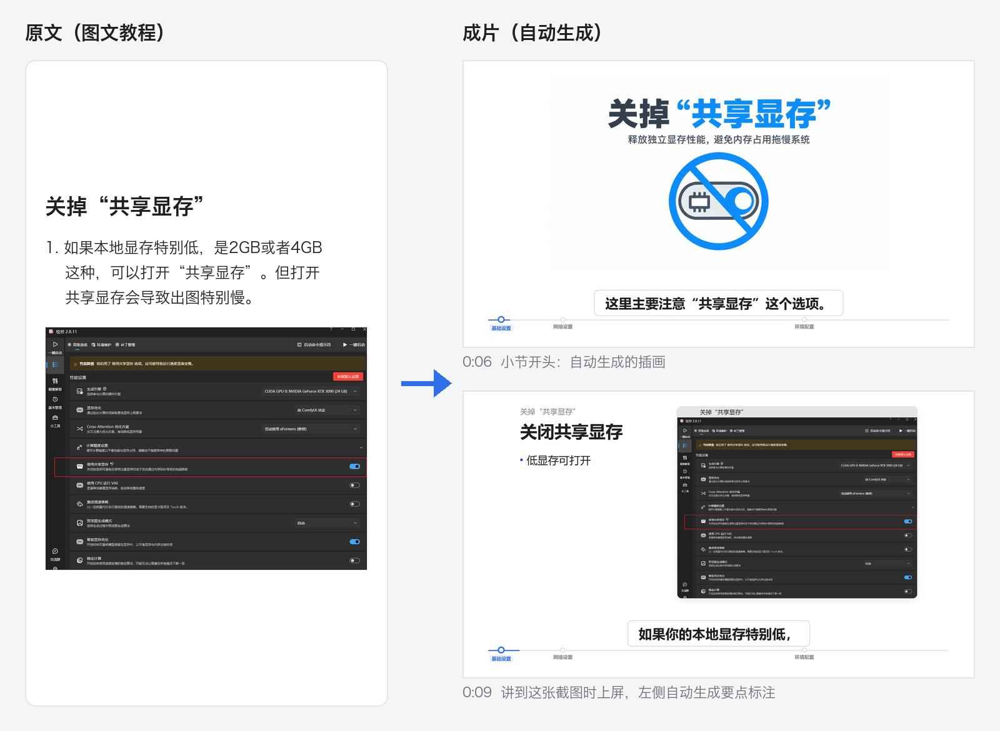
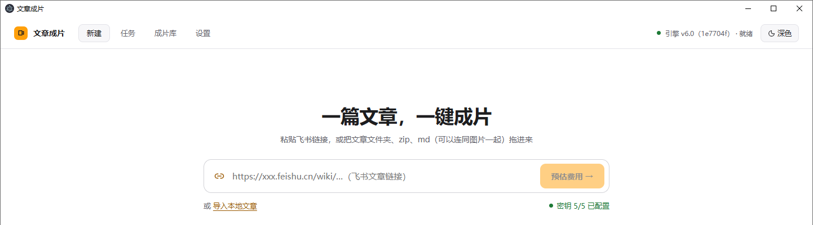
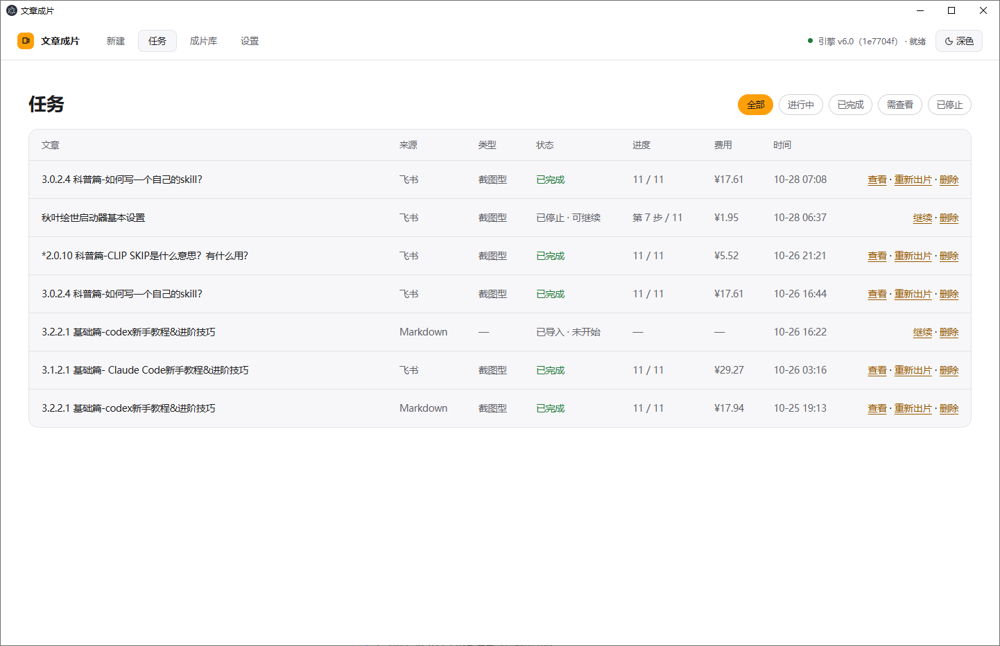
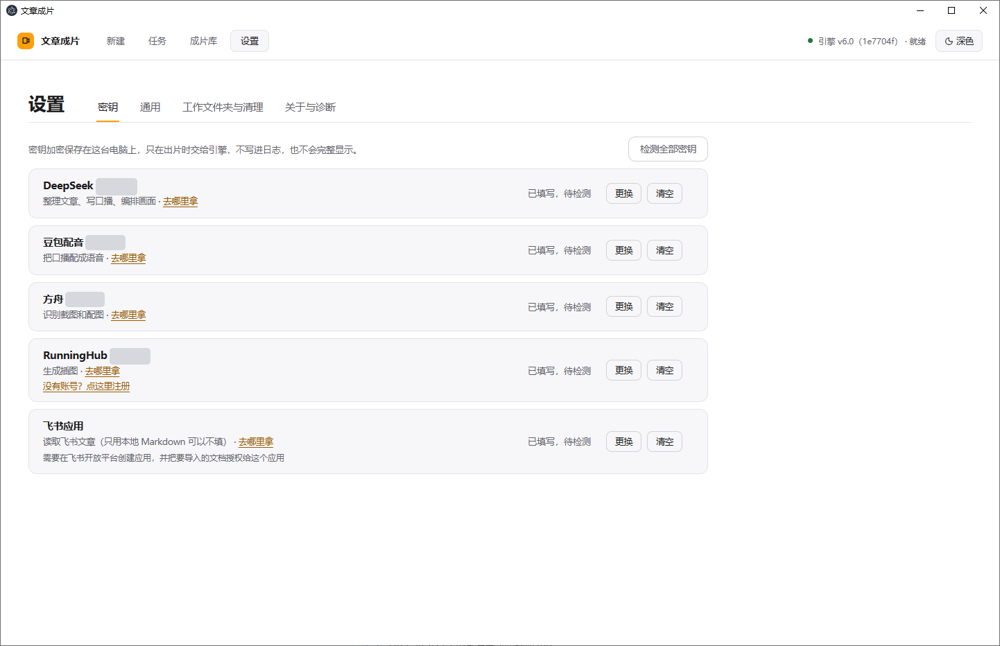
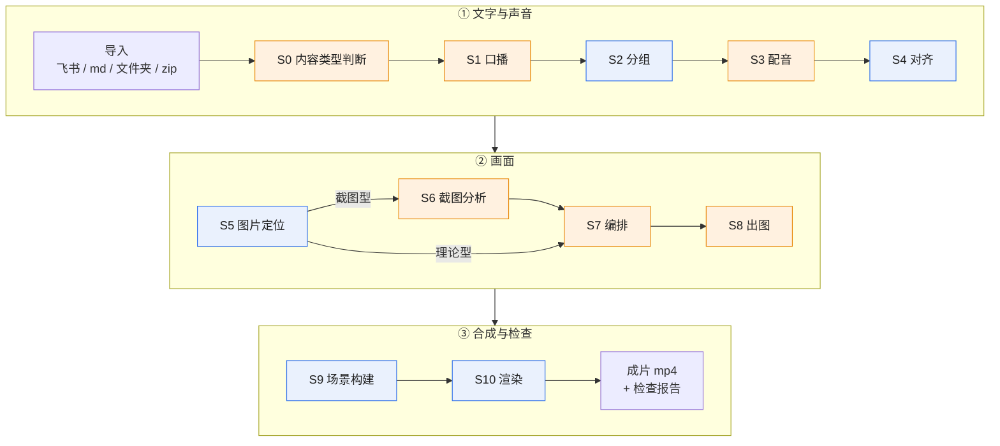

# 文章成片

**把一篇图文教程一键变成带配音、字幕、插画、截图标注的讲解视频。**

<p>
  <a href="https://github.com/Chopper888/qb-article2video/releases"></a>
  <a href="LICENSE"></a>
  
  <a href="https://github.com/Chopper888/qb-article2video/releases"></a>
</p>

[演示](#效果展示) · [为什么做](#为什么做这个项目) · [运行逻辑](#运行逻辑) · [快速开始](#快速开始) · [下载](#方式一下载安装包推荐) · [扩展方向](#这是一个架子扩展方向) · [交流](#交流与反馈)

作者：乔巴（Chopper888）


- [观看完整演示视频（42 秒）](docs/demo.mp4)
- 更多完整成片：[B 站主页](https://space.bilibili.com/522625412)

> 本仓库是**框架 + 基础风格**：能完整出片，但画面朴素。下载的安装包用的是作者的完整风格，上面的演示就是安装包的效果。两者的区别见 [框架与风格](#框架与风格)。

## 效果展示

### 原文 → 成片

左边是原文里的一小节（一段文字 + 一张截图），右边是成片里对应的两个画面。



<sub>成片取自开源版基础风格对同一篇文章的出片（0:06、0:09 两帧），安装包完整风格的画面更丰富。</sub>

### 桌面应用


<details>
<summary>更多界面：新建、任务、设置</summary>

| 新建：粘贴飞书链接，或拖入文章 | 任务：进度和每篇的实际费用 |
|:---:|:---:|
|  |  |

**设置：** 密钥加密保存在本机，界面上只显示是否已填写。



</details>

### 实测数据

以下是安装包（完整风格）的真实出片记录：

| 文章 | 类型 | 成片时长 | 费用 |
|---|---|---|---|
| 秋叶绘世启动器基本设置 | 截图型 | 2:14 | 约 ¥6 |
| 2.0.10 科普篇-CLIP SKIP 是什么意思？有什么用？ | 截图型 | 3:51 | ¥5.52 |
| 3.0.2.4 科普篇-如何写一个自己的 skill？ | 截图型 | 12:59 | ¥17.61 |
| 3.1.2.1 基础篇-Claude Code 新手教程&进阶技巧 | 截图型 | 25:33 | ¥29.27 |

费用是按量计费的实际花费，会随文章长度、截图数量变化。完整成片见 [B 站主页](https://space.bilibili.com/522625412)。

## 为什么做这个项目

我喜欢写文章。文字更适合把逻辑讲清楚，干货也写得最扎实。

但现在大多数人更愿意看视频，认真写的干货文章，往往没有多少人读。

文章成片想做的事很简单：让只会写文章、不会剪视频的人，也能把自己的内容变成视频，多一种被看到的方式。

## 它能做什么

1. **截图自动对上口播。** 判断每句口播在讲哪张截图，讲到时才让截图上屏，并在截图旁自动生成要点标注、在截图上框出重点位置。
2. **自动区分理论型 / 截图型文章。** 文章里有真实软件截图就走截图型流程（多一步截图分析），没有就走理论型流程，以插画为主。
3. **多种导入方式。** 支持飞书文档链接、本地 Markdown、文件夹、zip；飞书里嵌套列表、折叠标题下的图片和文字也能完整导入。导入时先检查图片引用和编码，有问题在花钱之前就拦下。
4. **先估算，再花钱。** 出片前可以估算费用范围；每篇都有费用上限，超了就停。所有付费请求按内容缓存，改过文章重跑时，内容没变的请求直接用缓存，不重复付费。
5. **自动质检。** 出片后生成检查报告：画面底线、原图和要素是否都出现、画面出现时机是否提前 / 推后、音画是否同步、成片声音是否就是本次配音。
6. **三种用法。** 安装包开箱即用；也可以从源码运行；或者交给 Claude Code、Codex 这类 Agent 调用（见 [AGENTS.md](AGENTS.md)）。

## 运行逻辑

一篇文章从导入到成片，要经过 S0～S10 共 11 步。理论型文章跳过 S6。



<sub>橙色 = 会调用按量付费服务（命中缓存时不花钱）；蓝色 = 本地计算，不花钱。</sub>

| 步骤 | 做什么 | 用什么服务 | 产出 | 付费 |
|---|---|---|---|---|
| S0 内容类型判断 | 判断是理论型还是截图型：导入时手动指定了就用指定的；否则逐张识别文章配图，有真实截图就是截图型 | 火山方舟（识图） | `00-输入/类型判断.json` | 是（指定类型或图片已识别过时不花钱） |
| S1 口播 | 把文章改写成口语化的口播稿，并检查、改写念出命令行的句子 | DeepSeek | `01-口播/narration.txt` | 是 |
| S2 分组 | 把口播切句、分组，标出章节标题 | 本地 | `02-分组/groups_raw.json` | 否 |
| S3 配音 | 把整篇口播合成一条配音，同时拿到每个字的时间 | 豆包语音 | `03-配音/` 下的音频和逐句时间 | 是 |
| S4 对齐 | 把每组口播对到配音时间轴上（字级） | 本地 | `04-对齐/alignment.json` 等 | 否 |
| S5 图片定位 | 找出原文里每张图在哪一组口播附近，区分截图和非截图 | 本地 | `image_map.json` | 否 |
| S6 截图分析（仅截图型） | 判断哪句口播在讲哪张截图、截图停留多久；决定截图上要高亮什么，再看图找到它的位置 | DeepSeek + 火山方舟 | `05-截图分析/` 下的分析结果 | 是 |
| S7 编排 | 决定哪些地方配插画、每张画什么；截图型还会排出最终时间轴，并为截图生成逐句标注 | DeepSeek | `06-编排/出图需求.json` 等 | 是 |
| S8 出图 | 按出图清单逐张生成插画和标题图，已有的不重出 | RunningHub（GPT Image 2） | `07-出图/images/*.png` | 是 |
| S9 场景构建 | 把配音、字幕、截图、插画排成逐帧场景数据，并写第一版检查报告 | 本地 | `08-场景/video_data.json` | 否 |
| S10 渲染 | 用 Remotion 渲染成片，抽帧和听音核对后刷新检查报告 | 本地（Remotion + FFmpeg） | `09-成片/*.mp4`、`10-报告/检查报告.md` | 否 |

每一步的名称、输入和产出以 [`engine/pipeline/engine/spec.py`](engine/pipeline/engine/spec.py) 为准，实现在 [`engine/pipeline/engine/steps.py`](engine/pipeline/engine/steps.py)。更多结构说明见 [架构说明](docs/架构说明.md)。

### 框架与风格

文章成片分成两层：

- **框架**：上面这 11 步的流程、每步的判断逻辑、缓存与续跑、检查报告、桌面应用。这部分完全开源，就在本仓库里。
- **风格**：各步骤的提示词、口播模板、插画类型和插画提示词、配色、字体、字幕和版式。本仓库带的是**基础风格**（白底、深灰字、单一蓝色强调、系统字体）；安装包里是作者打磨过的**完整风格**。

框架不变，换一套风格文件，出来的就是另一种视频。想做自己的风格，看 [风格定制指南](docs/风格定制指南.md)。

## 质量与成本把关

- **检查报告**：每篇都会生成 `10-报告/检查报告.md`，第一行是总体结论（通过 / 有提示 / 标红）。标红项包括画面底线未过、配音漏读、插画缺失、要素未上屏、成片声音与本次配音不符、口播仍念命令；提示项包括画面提前 / 推后出现、音画时长差超过 1 秒等。有标红时成片照样输出，退出码为 1，提醒你看一眼。
- **费用估算与上限**：`estimate` 在开跑前给出费用范围，不联网、不需要密钥。每篇有费用上限（默认 50 元，可用 `--max-cost-cny` 调整），每次付费请求发出之前都会检查，超了就停。
- **缓存复用**：所有付费请求按请求内容缓存在文章文件夹里。重跑、续跑时内容没变的请求直接用缓存，不再花钱。
- **口播定稿锁**：口播、分组、配音都成功后会落一把定稿锁，之后重跑不会重新生成口播和配音；原文改了会自动解锁重做，你手改过口播则会停下来让你选。
- **断点续跑**：每一步的状态记在进度账本里。中断、失败后再次运行，已完成的步骤自动跳过，从断点接着跑；已提交的配音、出图任务号先记账，续跑时接着取结果，不重复提交。

命令和参数细节见 [命令行与常见问题](docs/命令行与常见问题.md)。

## 快速开始

### 方式一：下载安装包（推荐）

不用装 Python / Node / FFmpeg，装完填好 API Key 就能用。

- GitHub Releases：<https://github.com/Chopper888/qb-article2video/releases>
- 夸克网盘（国内推荐）：<https://pan.quark.cn/s/03ebea3c47ef>

最新版本 1.1.0，使用作者完整风格。

- 系统要求：Windows 10 / 11（64 位）
- 首次运行时 Windows SmartScreen 可能提示「Windows 已保护你的电脑」：点「更多信息」→「仍要运行」即可。
- 在「设置」里填入各服务的 API Key，就可以导入文章、开始生成。

### 方式二：从源码运行

适合想改代码、换风格、做二次开发的人。

**环境要求**

| 组件 | 版本 |
|---|---|
| Python | 3.12 |
| Node.js | 24（含 npm） |
| FFmpeg | 任意较新版本（需在 PATH 中，且带 `ffprobe`） |

FFmpeg 可从 <https://ffmpeg.org/download.html> 获取，Windows 也可以用 <https://www.gyan.dev/ffmpeg/builds/> 的 full 构建。终端里执行 `ffmpeg -version` 能显示版本即可。

**安装依赖**

```powershell
# Python 依赖（在仓库的 engine 目录下）
cd engine
python -m venv .venv
.\.venv\Scripts\Activate.ps1
pip install -r requirements.txt

# 渲染工程的 Node 依赖（只需要装一次）
cd R57-render-test
npm install
```

`engine\R57-render-test` 装完依赖后就是运行时目录，运行时用 `--runtime-dir` 指向它。

**配置密钥**

```powershell
# 在仓库根目录
Copy-Item .env.example .env
notepad .env   # 填入真实密钥
```

引擎只从**进程环境变量**读取密钥，不会自动解析 `.env`。请在运行引擎的同一个终端里加载：

```powershell
Get-Content .env | Where-Object { $_ -match '^\s*[^#].*=' } | ForEach-Object {
  $k, $v = $_ -split '=', 2
  [Environment]::SetEnvironmentVariable($k.Trim(), $v.Trim(), 'Process')
}
```

| 变量 | 用途 | 是否必填 |
|---|---|---|
| `DEEPSEEK_API_KEY` | 口播稿、截图分析、编排等文本生成 | 必填 |
| `ARK_API_KEY` | 火山方舟，文章配图识别 | 必填 |
| `MODEL_SPEECH_API_KEY` | 豆包语音，配音合成 | 必填 |
| `RUNNINGHUB_API_KEY` | RunningHub，插画与标题图 | 必填 |
| `FEISHU_APP_ID` / `FEISHU_APP_SECRET` | 飞书文档导入 | 可选 |
| `A2V_TTS_SPEAKER` | 配音音色，留空用公共音色（说明见 `.env.example`） | 可选 |

**三条核心命令**（在 `engine` 目录下执行）

```powershell
# 1) 导入文章（飞书链接 / 本地 .md / 文件夹 / .zip）
python -m pipeline.engine import --work-root "$env:USERPROFILE\article2video\工作" --input "https://my.feishu.cn/wiki/..."

# 2) 估算费用（不联网、不需要密钥）
python -m pipeline.engine estimate --work-root "$env:USERPROFILE\article2video\工作" --article "文章文件夹名"

# 3) 出片
python -m pipeline.engine run --work-root "$env:USERPROFILE\article2video\工作" --article "文章文件夹名" --delivery-root "$env:USERPROFILE\article2video\成片" --runtime-dir "<仓库路径>\engine\R57-render-test" --max-cost-cny 20
```

成片在 `<delivery-root>\<文章文件夹名>\<文章文件夹名>.mp4`，检查报告在 `<work-root>\<文章文件夹名>\10-报告\检查报告.md`。

完整参数表、退出码、续跑与重做的用法见 [命令行与常见问题](docs/命令行与常见问题.md)。

### 申请 API Key

本项目需要以下服务，均为按量计费，充值少量即可跑通一篇文章：

- **DeepSeek**：<https://platform.deepseek.com/>
- **火山方舟（豆包大模型 / 识图）**：<https://www.volcengine.com/product/ark>
- **豆包语音合成（TTS）**：<https://www.volcengine.com/product/tts> —— 默认使用公共音色，需要在火山引擎开通**「语音合成大模型」**；如果想用自己的声音，另外开通**「声音复刻」**，并在设置 / 环境变量 `A2V_TTS_SPEAKER` 中填音色编号。
- **RunningHub（插画与标题图）**：<https://www.runninghub.ai> —— 没有账号？[点这里注册](https://www.runninghub.ai?inviteCode=rh-v1419)
- **飞书开放平台（可选，用于导入飞书文档）**：<https://open.feishu.cn/>

各平台的具体开通步骤以官方文档为准。

## 这是一个架子：扩展方向

文章成片是一个**框架**，不是最终成品。当前开源版的效果是基础的，很多地方还能持续优化。

- **想要自动化批量出片**：研究风格文件，做出你自己的风格。提示词、模板、配色、字体都是独立的文件，改它们不需要动流程代码。从 [风格定制指南](docs/风格定制指南.md) 开始。
- **想要更炫的视频**：把文章成片当作一个 skill，交给 Agent 调度（入口说明见 [AGENTS.md](AGENTS.md)）；再结合 Remotion（本仓库的渲染层已经在用）等开源视频框架做动效和运镜。也可以结合 HyperFrames 等其他开源视频框架，这部分不在本仓库里，需要自己接入。

我会继续打磨风格和流程，也欢迎提 Issue / PR 一起完善。

## 局限

说清楚现在做不到的：

- 安装包只有 Windows 版。
- 只支持中文文章和中文配音。
- 需要 4 个按量付费的服务：DeepSeek、火山方舟、豆包语音、RunningHub。没有免费跑通的路径。
- 开源版是基础风格，画面朴素；完整风格只在安装包里。
- 渲染用的 Remotion 对超过 3 人的公司有商用授权要求，详见 [THIRD-PARTY-NOTICES.md](THIRD-PARTY-NOTICES.md)。

## 自己打包

打包脚本在 `app/scripts/packaging/`，需要 Windows + PowerShell：

```powershell
cd app
./scripts/packaging/build-installer-v5.7.ps1 `
  -BuildPython <宿主 Python 3.12> `
  -EngineSource <引擎目录> `
  -RuntimeSource <运行时源目录> `
  -SampleSource <样本源目录> `
  -DeliveryRoot <交付目录>
```

脚本会自动下载并校验所需的 Python、Node、wheel、FFmpeg 等外部资产（默认先查 `app/assets-mirror`），然后组装运行时并打 NSIS 安装包。打出的是**本仓库的基础风格**，不含作者的完整风格。

## 参与贡献

欢迎提 Issue 和 PR。遇到问题请尽量附上：运行命令、退出码、`10-报告\检查报告.md` 的内容。

## 交流与反馈

使用中遇到问题、有功能建议，欢迎交流；也可以直接在 GitHub 提 Issue 或 PR。

| 微信（进交流群） | 公众号 |
|:---:|:---:|
|  |  |
| 加好友备注「**文章成片**」，拉你进群 | 关注获取更新和教程 |

🔗 [知识星球](https://t.zsxq.com/GFfis) · [B站主页](https://space.bilibili.com/522625412)

## 许可证

本项目以 MIT 许可发布，见 [LICENSE](LICENSE)。

Remotion、FFmpeg 等第三方组件的许可与使用限制见 [THIRD-PARTY-NOTICES.md](THIRD-PARTY-NOTICES.md)。
